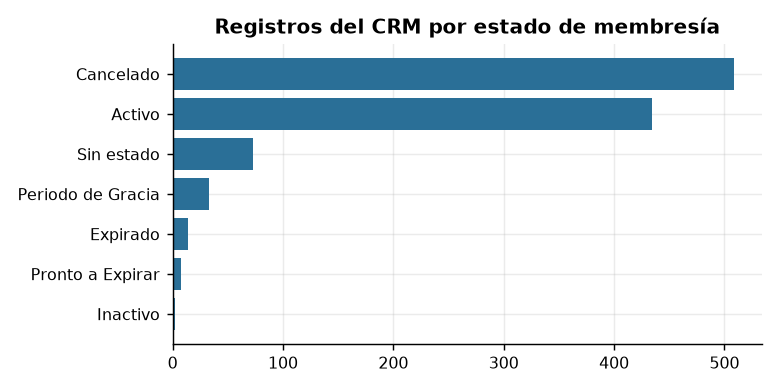
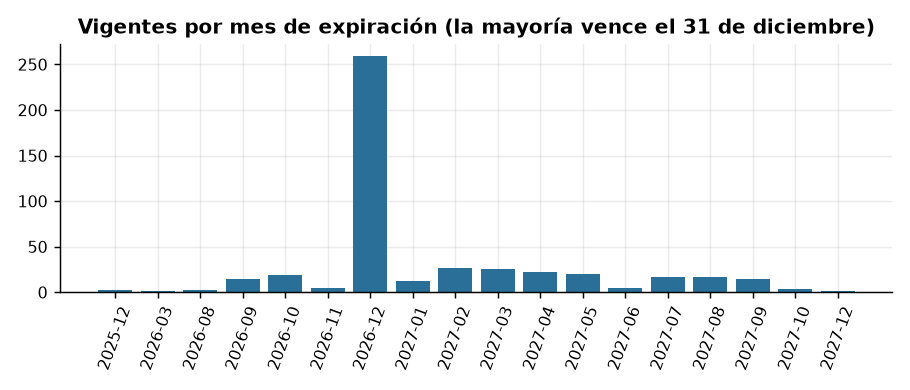
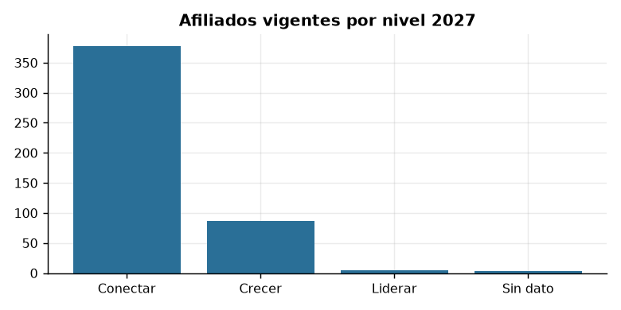
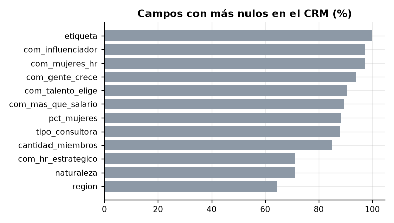

# Perfilado del CRM (Zoho)

El CRM trae 1,073 filas y 33 campos útiles tras descartar los campos eliminados por la anonimización. Tras excluir 2 registros de prueba y consolidar 21 códigos repetidos quedan 1,050 empresas únicas, de las cuales 474 están vigentes.

## Estados de membresía

| estado | registros |
|---|---|
| Cancelado | 509 |
| Activo | 434 |
| Sin estado | 73 |
| Periodo de Gracia | 33 |
| Expirado | 14 |
| Pronto a Expirar | 8 |
| Inactivo | 2 |

## Vencimientos

Los vencimientos se concentran en una sola fecha: 259 afiliados vigentes expiran el 31 de diciembre de 2026, lo que explica que 302 afiliaciones venzan en los próximos 60 días. 41 afiliados siguen vigentes aunque su fecha ya pasó.

## Nivel, tipo y sector de los vigentes

| tipo | afiliados |
|---|---|
| Empresa | 337 |
| Consultora | 111 |
| Persona natural | 16 |
| Universidad | 10 |

| sector | afiliados |
|---|---|
| Servicios | 131 |
| Finanzas | 55 |
| Comercio | 50 |
| Tecnología | 34 |
| Industria | 32 |
| Educación | 32 |
| Energético, Hidrocarburos y Minería | 25 |
| Logística y Transporte | 23 |
| Construcción | 20 |
| Farmacéutico y químicos | 18 |

## Categoría de membresía frente a estado (datos crudos)

La columna de categoría mezcla niveles reales (Estándar, Premium, Elite) con valores de tipo (Empresas, Consultoras, Persona Natural), sobre todo en cuentas canceladas.

| categoria_membresia | Activo | Cancelado | Expirado | Inactivo | Periodo de Gracia | Pronto a Expirar | Sin estado |
|---|---|---|---|---|---|---|---|
| (vacío) | 1 | 146 | 0 | 0 | 0 | 0 | 44 |
| Consultoras | 1 | 34 | 0 | 0 | 0 | 0 | 0 |
| Elite | 4 | 4 | 0 | 0 | 1 | 0 | 3 |
| Empresas | 0 | 48 | 0 | 0 | 0 | 0 | 0 |
| Estandar | 29 | 2 | 0 | 0 | 0 | 0 | 0 |
| Estándar | 318 | 172 | 8 | 2 | 25 | 5 | 20 |
| Estándar Colaborador | 0 | 21 | 0 | 0 | 0 | 0 | 0 |
| Persona Natural | 2 | 34 | 0 | 0 | 0 | 0 | 0 |
| Personal | 4 | 8 | 1 | 0 | 0 | 0 | 0 |
| Plus | 0 | 1 | 0 | 0 | 0 | 0 | 0 |
| Premium | 75 | 39 | 5 | 0 | 7 | 3 | 6 |

## Nulos

| campo | % nulo |
|---|---|
| etiqueta | 99,8 |
| com_influenciador | 97,2 |
| com_mujeres_hr | 97,1 |
| com_gente_crece | 93,8 |
| com_talento_elige | 90,4 |
| com_mas_que_salario | 89,6 |
| pct_mujeres | 88,3 |
| tipo_consultora | 87,9 |
| cantidad_miembros | 85,1 |
| com_hr_estrategico | 71,3 |
| naturaleza | 71,2 |
| region | 64,5 |
| tamano | 56,8 |
| miembro_desde | 52,9 |
| independiente | 44,7 |

