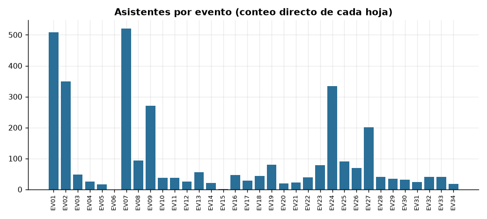
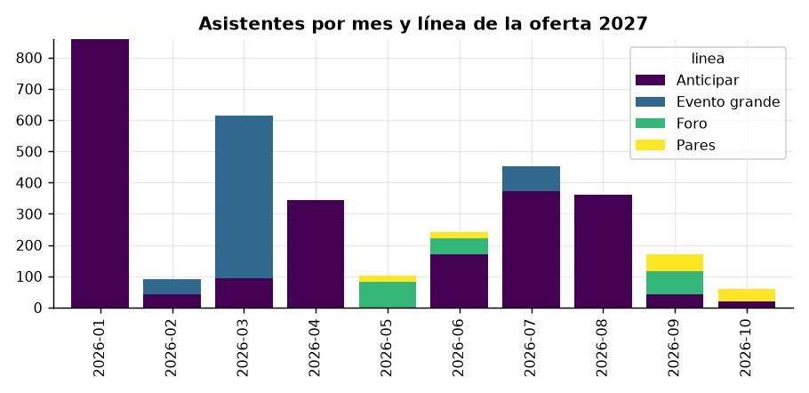
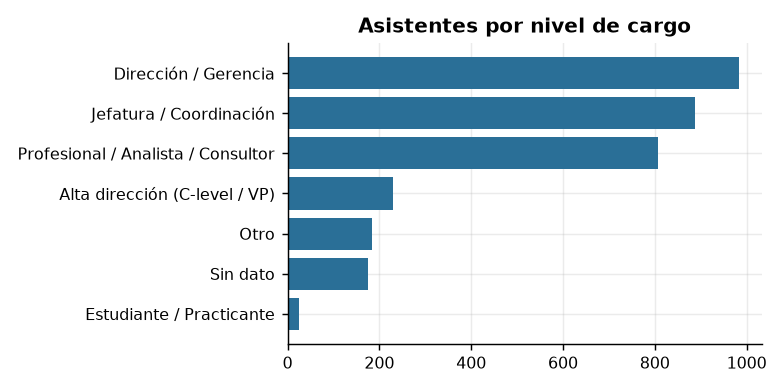

# Perfilado de la asistencia a eventos 2026

El libro tiene 34 eventos con asistencia (la hoja de febrero 13 no trae lista de inscritos), 3,386 registros de inscripción y 3,292 asistencias válidas después de descartar 82 repetidos de persona y evento y 12 registros en estado agendado. De esas asistencias, 2,238 corresponden a empresas del CRM y 1,054 a empresas que no aparecen en el CRM.

## La hoja consolidada subestima la participación

La hoja GENERAL calcula las asistencias con COUNTIFS cuyos rangos terminan en filas muy anteriores al final de cada hoja (por ejemplo, la hoja de enero 5 se cuenta hasta la fila 138 y tiene más de 500 registros). Además, la columna del evento 27 no tiene fórmula y las columnas 35 y 36 están vacías. La hoja lista solo 568 empresas y deja fuera a 791 empresas con asistencia real. Sumando sus valores calculados se obtiene 1,285 asistencias (columna de total: 1,265), frente a 3,292 contadas directamente en las hojas (2,238 si solo se cuentan empresas del CRM).

## Eventos

| evento_id | fecha | nombre | linea | modalidad | asistentes |
|---|---|---|---|---|---|
| EV01 | 2026-01-05 | Webinar: Salario mínimo 2026 en Colombia: preguntas, retos y | Anticipar | Virtual | 508 |
| EV02 | 2026-01-13 | Webinar: Equilibrio entre personas y negocios. Conversacione | Anticipar | Virtual | 350 |
| EV03 | 2026-02-04 | Foro híbrido de tendencias | Evento grande | Híbrido | 48 |
| EV04 | 2026-02-10 | Sesiones de trabajo de proyecciones salariales: ajuste salar | Anticipar | Presencial | 25 |
| EV05 | 2026-02-12 | Sesiones de trabajo de proyecciones salariales: ajuste salar | Anticipar | Presencial | 17 |
| EV06 | 2026-02-13 | Live: Suspensión al alza del salario mínimo 2026 | Anticipar | Virtual | 0 |
| EV07 | 2026-03-17 | Semana del Talento (17 al 20 de marzo) | Evento grande | Presencial | 521 |
| EV08 | 2026-03-25 | Webinar Decreto 0234 de 2026: cambios en la negociación cole | Anticipar | Virtual | 94 |
| EV09 | 2026-04-16 | Webinar: Tolerancia cero: cómo prevenir y gestionar el acoso | Anticipar | Virtual | 271 |
| EV10 | 2026-04-28 | Taller: Gestión del acoso sexual en las organizaciones (Bogo | Anticipar | Presencial | 37 |
| EV11 | 2026-04-30 | Taller: Gestión del acoso sexual en las organizaciones (Mede | Anticipar | Presencial | 37 |
| EV12 | 2026-05-05 | Foro de Soluciones: Personas y organizaciones más felices | Foro | Presencial | 26 |
| EV13 | 2026-05-21 | Foro de Gestión Humana: El colaborador en el centro de la es | Foro | Presencial | 55 |
| EV14 | 2026-05-22 | HR Detox | Pares | Presencial | 21 |
| EV15 | 2026-05-29 | Leader Talks Sensorial: ¿A qué sabe el futuro del talento hu | Pares | Presencial | 1 |
| EV16 | 2026-06-01 | Foro Talento 2026: Gestión humana y derecho laboral (Bogotá) | Anticipar | Presencial | 46 |
| EV17 | 2026-06-03 | Foro de Gestión Humana: El valor de crear un mundo para todo | Foro | Presencial | 29 |
| EV18 | 2026-06-10 | Foro Talento 2026: Gestión humana y derecho laboral (Medellí | Anticipar | Presencial | 43 |
| EV19 | 2026-06-12 | Webinar Decreto 0581 de 2026: claves para actuar con calma,  | Anticipar | Virtual | 80 |
| EV20 | 2026-06-18 | Tardes de bienestar | Pares | Presencial | 19 |
| EV21 | 2026-06-24 | Foro de Gestión Humana: Felicidad laboral en Colombia | Foro | Presencial | 23 |
| EV22 | 2026-07-16 | Webinar: ¿Qué viene en materia laboral? Claves normativas pa | Anticipar | Virtual | 39 |
| EV23 | 2026-07-23 | HR Global Day: tecnología y talento estratégico | Evento grande | Presencial | 78 |
| EV24 | 2026-07-28 | De la norma a la estrategia: el futuro de las relaciones lab | Anticipar | Presencial | 334 |
| EV25 | 2026-08-18 | Webinar: Después de la emergencia, ¿cómo acompañar a tus equ | Anticipar | Virtual | 90 |
| EV26 | 2026-08-19 | Webinar: Cómo gestionar jurídicamente la crisis por desastre | Anticipar | Virtual | 70 |
| EV27 | 2026-08-27 | Webinar: Depuración normativa laboral | Anticipar | Virtual | 201 |
| EV28 | 2026-09-02 | Foro de Soluciones: ¿Cuánto le cuesta a tu empresa no saber  | Foro | Presencial | 40 |
| EV29 | 2026-09-16 | Foro de Soluciones: El nuevo mapa del talento global | Foro | Presencial | 34 |
| EV30 | 2026-09-23 | Foro de Gestión Humana: Liderazgo femenino sin estereotipos | Pares | Presencial | 31 |
| EV31 | 2026-09-25 | Conferencia Liderazgo sin Anestesia | Pares | Presencial | 24 |
| EV32 | 2026-09-29 | Foro de Gestión Humana: El reto de democratizar la IA | Anticipar | Presencial | 41 |
| EV33 | 2026-10-27 | Actho de Valentía: Cuando la IA no salió como esperábamos (M | Pares | Presencial | 41 |
| EV34 | 2026-10-27 | Taller de nómina (Bogotá) | Anticipar | Presencial | 18 |

## Nivel de cargo

## Encabezados heterogéneos

Cada hoja usa encabezados distintos (ID_EMPRESA, EMPRESA, Celular, cédula, columnas de consentimiento con nombres diferentes y una primera columna sin título cuyo valor es 1 o 2). El pipeline localiza la columna por su nombre y no por su posición. Los valores de autorización de datos aparecen escritos de varias formas distintas (SI, Sí, SÍ, Si, entre otras).
