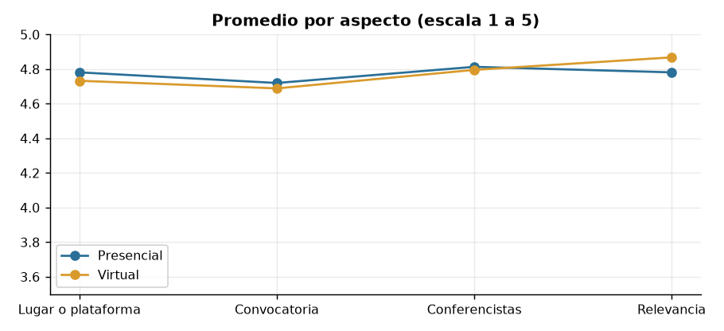
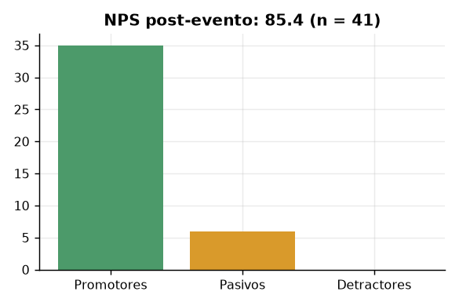
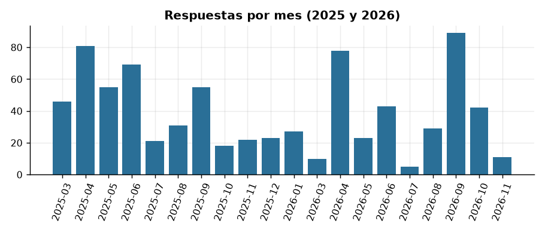

# Perfilado de las encuestas

Hay 407 respuestas presenciales, 318 virtuales y 53 post-evento (41 con NPS). La encuesta de 90 días solo tiene el instrumento, sin respuestas (0).

## Escala 1 a 5

Las calificaciones se concentran en 4 y 5 (satisfacción media 4.78), por lo que la variación entre afiliados es pequeña y un promedio menor a 4,5 ya es una señal relativamente baja.

## NPS post-evento

Promotores 35, pasivos 6, detractores 0: NPS de 85.4. Coincide con el cálculo manual esperado de 35, 6 y 0. La muestra es pequeña y, entre quienes se declaran no afiliados, el NPS es de 95.5; entre afiliados, de 73.7.

## Las encuestas sí traen empresa, pero no evento

636 de 778 respuestas traen un código de empresa válido (el resto, 142, no identifica empresa). Ninguna trae el evento: se infiere por la fecha de respuesta y la modalidad, con una ventana de 2 días después del evento.

| metodo_evento | respuestas |
|---|---|
| fuera de 2026 | 421 |
| fecha | 304 |
| ambiguo (varios eventos el mismo día) | 39 |
| sin evento en la ventana | 14 |

Las respuestas de 2025 (el colector se reutilizó) no tienen evento en el libro 2026 y se conservan solo para la satisfacción por empresa. Las ambiguas corresponden a dos eventos presenciales el mismo día (27 de octubre).

## Cómo se asignó la empresa en la exportación

| metodo_asignacion | respuestas |
|---|---|
| Correo exacto | 268 |
| Nombre de empresa | 153 |
| Sin datos de empresa | 142 |
| Dominio del correo | 138 |
| Sin coincidencia (empresa nueva) | 77 |

La asignación por dominio del correo es la menos precisa; se conserva el método para que el equipo pueda filtrar por confianza.
