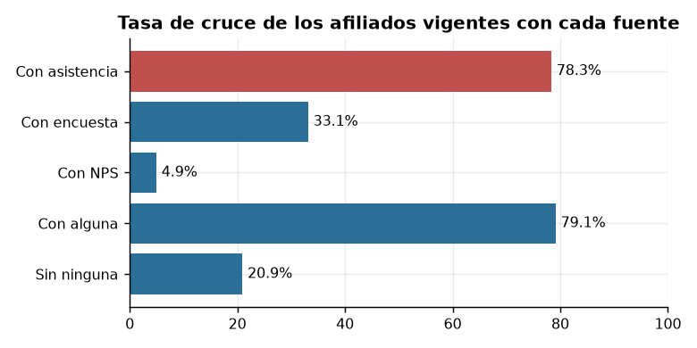

# Integración y tasa de cruce

La clave de unión es el código de empresa (formato EMP-0000, columna «Nombre de Empresa» del CRM, «ID_EMPRESA» en asistencia y encuestas). Es un código anonimizado que reemplaza al NIT; no se hizo ningún intento de reidentificar empresas. Si el código viene vacío o con formato distinto, el registro no se une.

## Tasa de cruce con 474 afiliados vigentes

21.7% de los afiliados vigentes no se cruza con ninguna asistencia de 2026 y 66.9% no se cruza con ninguna respuesta de encuesta. El 20.9% no aparece en ninguna de las dos fuentes. Solo 23 afiliados (4.9%) tienen una respuesta con NPS, por lo que el NPS por afiliado no es utilizable todavía; la satisfacción por afiliado se apoya en las encuestas presenciales y virtuales de los últimos 12 meses.

| nivel | afiliados | con_asistencia | con_encuesta |
|---|---|---|---|
| Conectar | 378 | 77,8 | 23 |
| Crecer | 87 | 82,8 | 21,8 |
| Liderar | 5 | 100 | 80 |
| Sin dato | 4 | 0 | 0 |

## Participantes no afiliados

823 empresas con asistencia en 2026 no están vigentes en el CRM (1,054 registros de empresas fuera del CRM y el resto de exafiliadas o sin estado). Son candidatas a campañas de afiliación. La lista de mayor frecuencia se exporta en segmentos.json.

## Modelo integrado

Una fila por afiliado vigente (afiliados.json) con campos del CRM, variables de asistencia y encuestas y score. Tablas auxiliares: eventos (catálogo con línea, modalidad, asistentes y satisfacción), asistencias (una fila por persona y evento), respuestas de encuesta (con evento inferido y método) y agregados de encuestas por modalidad, línea, mes y nivel del afiliado, porque las encuestas no identifican el evento.
