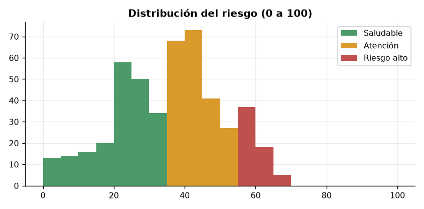
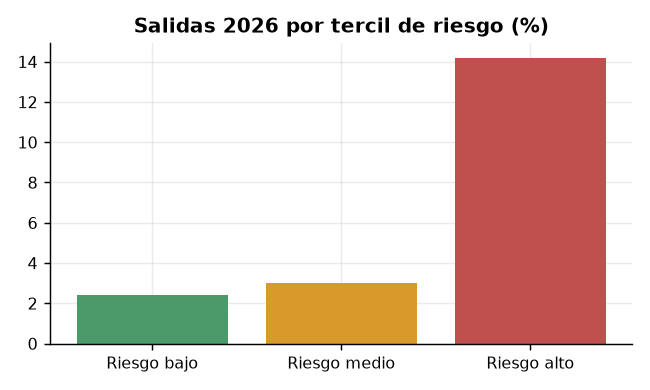
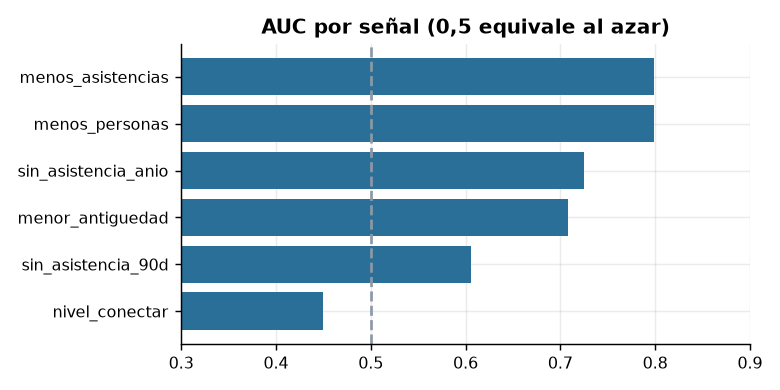

# Score de salud y riesgo, y su validación

## Diseño

El riesgo suma puntos por señales transparentes y se escala de 0 a 100 dividiendo por el máximo posible (76.0 puntos). Los pesos están en config/pesos_score.json. Bandas: Saludable (menos de 35), Atención (desde 35) y Riesgo alto (desde 55). Los umbrales se fijaron para que la lista de riesgo alto sea atendible en una semana; no provienen de un ajuste estadístico.

Resultado: Atención 209, Saludable 205, Riesgo alto 60.

Factor principal de cada afiliado:

| index | afiliados |
|---|---|
| vencimiento | 332 |
| sin_asistencia_90d | 95 |
| antiguedad | 29 |
| nivel | 8 |
| contacto_unico | 4 |
| comunidad | 3 |
| satisfaccion | 2 |
| una_sola_asistencia | 1 |

## Validación contra salidas históricas

Se aplicó el score, sin vencimiento, ejecutiva ni comunidad, a 33 empresas que salieron (cancelada, expirada o inactiva) con fecha de expiración entre abril y noviembre de 2026, tomando la asistencia hasta esa fecha, y a 474 vigentes a la fecha de corte. El AUC es 0.769 (intervalo de 95%: 0.692 a 0.846). El score muestra una asociación clara con la salida histórica en esta muestra; conviene reconfirmarla con más historia antes de automatizar decisiones.

| tercil | empresas | salieron | tasa de salida % |
|---|---|---|---|
| Riesgo bajo | 169 | 4 | 2,4 |
| Riesgo medio | 169 | 5 | 3 |
| Riesgo alto | 169 | 24 | 14,2 |

La participación es la señal más informativa: 33.3% de los que salieron tenía alguna asistencia registrada frente a 78.3% de los vigentes. El nivel Conectar no discrimina (AUC 0.45), por lo que su peso se dejó bajo y por criterio de negocio.

## Limitaciones

- Los afiliados que renovaron pierden su fecha de vencimiento anterior, por lo que no se pueden usar como casos negativos del mismo momento.
- La asistencia solo existe desde enero de 2026; se excluyen salidas anteriores a abril de 2026 por cobertura insuficiente.
- No se conoce la fecha real de cancelación; se usa la fecha de expiración como referencia.
- Los salientes son pocos, por lo que el resultado es una señal de asociación y no una garantía de predicción.
- Se excluyeron vencimiento, ejecutiva y comunidad: el primero es circular y los otros dos se reasignan tras la cancelación.
