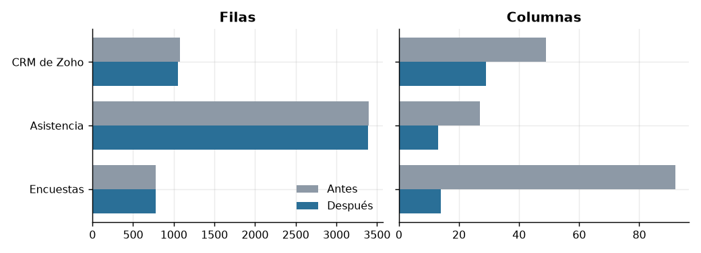
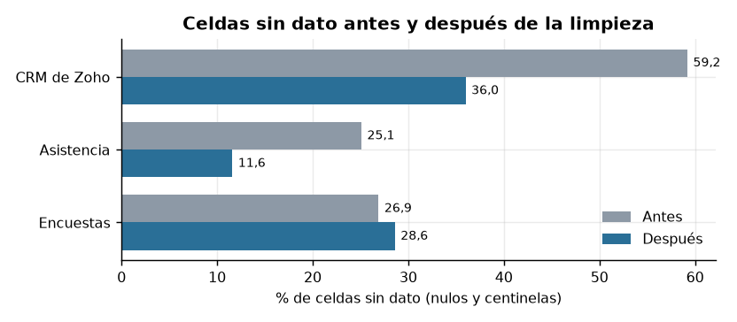
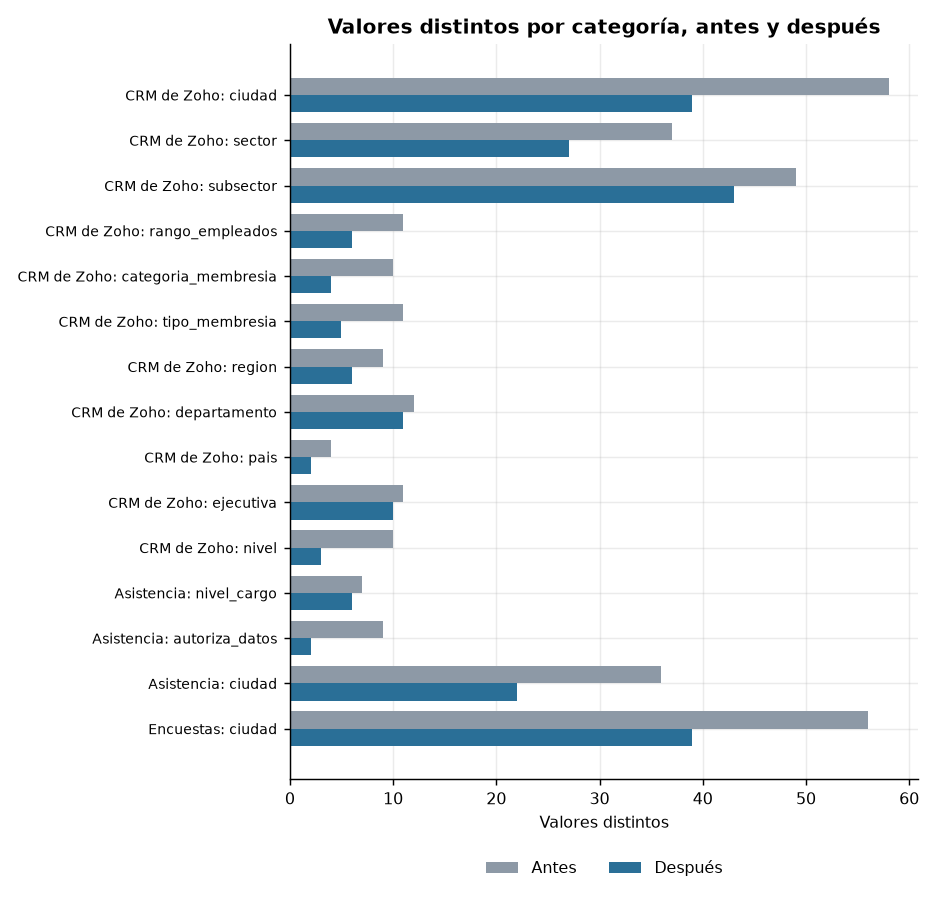
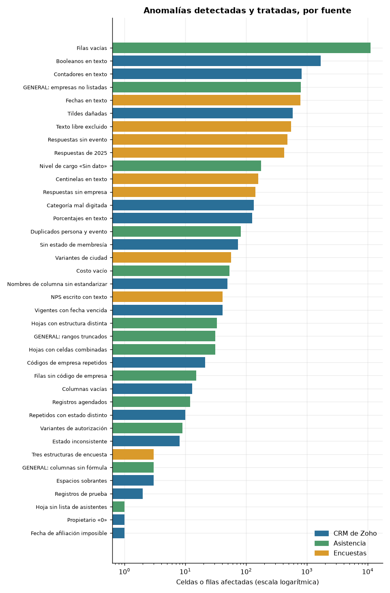
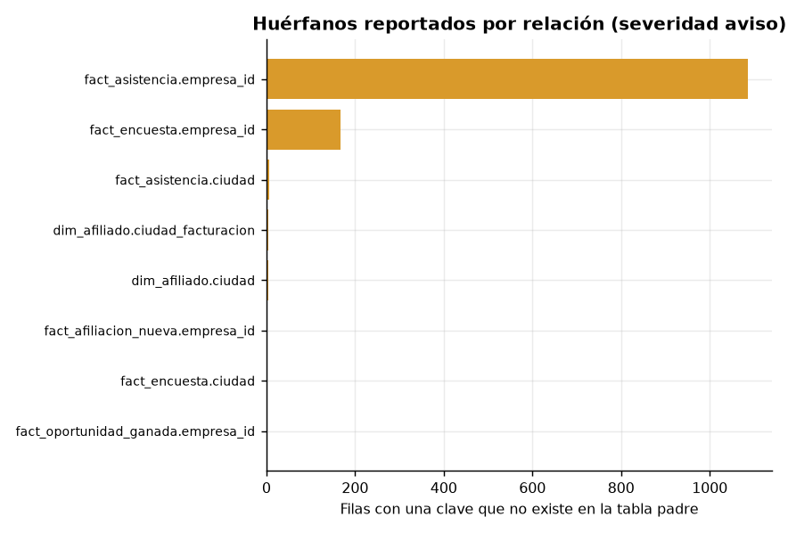
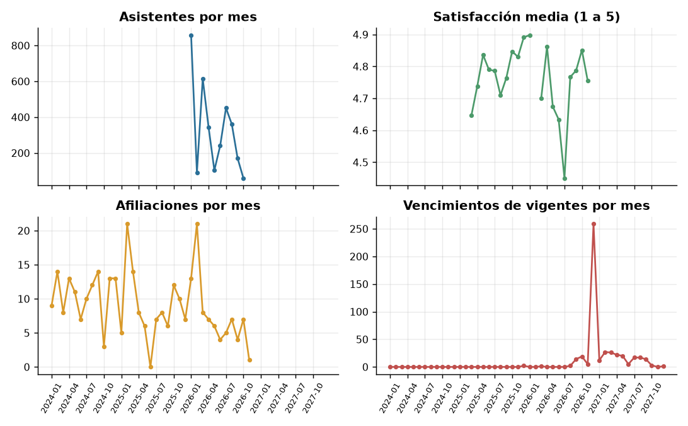

# Calidad de los datos antes y después de la limpieza

Las cifras vienen de la auditoría del pipeline (`pipeline/calidad.py`), que mide cada fuente original y la tabla del modelo normalizado que resulta de ella. El detalle completo, con la explicación de cada anomalía, está en `docs/LIMPIEZA.md` y en `data/processed/control_calidad.csv`.

## Resumen por fuente

| fuente | filas antes | filas después | columnas antes | columnas después | % sin dato antes | % sin dato después | duplicados por clave antes | duplicados por clave después |
|---|---|---|---|---|---|---|---|---|
| CRM de Zoho | 1073 | 1050 | 49 | 29 | 59,2 | 36 | 21 | 0 |
| Asistencia | 3401 | 3386 | 27 | 13 | 25,1 | 11,6 | 82 | 0 |
| Encuestas | 778 | 778 | 92 | 14 | 26,9 | 28,6 | 0 | 0 |

## Celdas sin dato

La mejora no viene de inventar datos: baja porque se eliminan las columnas vacías que dejó la anonimización, se unifican los centinelas («sin dato», «n/a», «-») en nulos reales y se descartan duplicados y registros de prueba.

## Categorías homologadas

## Anomalías tratadas

## Integridad referencial

El modelo tiene 33 relaciones entre tablas. Ninguna está rota; los huérfanos que quedan son esperados y están listados en `control_huerfanos.csv`: sobre todo empresas que asisten o responden sin estar en el CRM.

## Conciliación con los informes de Zoho

| descripcion | esperado | obtenido | coincide |
|---|---|---|---|
| Registros con estado Activo del CRM frente al total del informe de membresías. | 481 | 481 | sí |
| Combinaciones tipo y categoría del informe que coinciden con el recuento del CRM. | 14 | 14 | sí |
| Empresas del informe Elite y Premium que existen en el CRM. | 89 | 89 | sí |
| Empresas del informe cuya categoría en el CRM coincide con la del informe. | 89 | 89 | sí |
| Empresas del informe cuya fecha de expiración coincide con la del CRM. | 89 | 89 | sí |
| Afiliados de la base de ACTHO (472) frente a los vigentes que puntúa el pipeline. | 472 | 466 | no |
| Empresas renovadas que existen en el CRM. | 14 | 14 | sí |
| Renovaciones cuya nueva fecha de expiración ya está reflejada en el CRM. | 14 | 14 | sí |
| Oportunidades ganadas cuya empresa existe en el CRM. | 39 | 38 | no |
| Oportunidades cuya ejecutiva coincide con la del CRM. | 38 | 35 | no |
| Afiliaciones recientes cuya empresa existe en el CRM. | 14 | 14 | sí |
| Nuevos afiliados de agosto y septiembre que existen en el CRM. | 10 | 7 | no |
| Bloques del consolidado por KAM cuyo resumen coincide con sus filas. | 6 | 6 | sí |
| Empresas del consolidado por KAM cuyo total de asistentes coincide con el recuento del pipeline. | 460 | 183 | no |
| Asistentes que suma el consolidado por KAM frente a los que cuenta el pipeline para las mismas empresas. | 925 | 1950 | no |

## Series de tendencias (`web/data/tendencias.json`)

